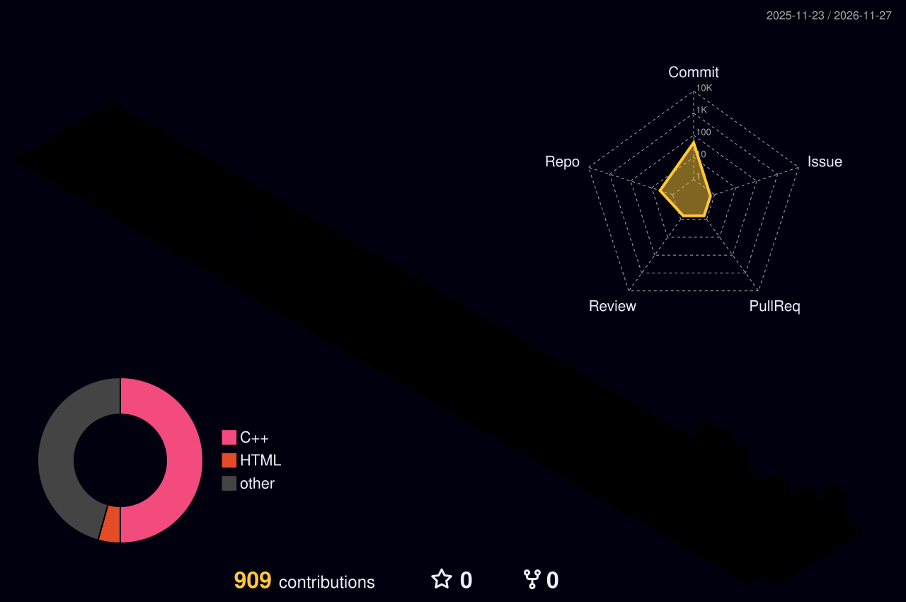

<p align="center">
  
</p>

<p align="center">
  <a href="https://github.com/b4el">
    
  </a>
</p>

<p align="center">
  <a href="https://www.linkedin.com/in/gabriel-leandro-da-rosa-568036198/"></a>
  <a href="https://www.instagram.com/biel_leandro2/"></a>
  <a href="https://www.twitch.tv/rd_b4el"></a>
  <a href="https://github.com/b4el"></a>
  
</p>

---

## 🧑‍💻 Sobre mim

```yaml
nome: Gabriel Leandro
papel: Desenvolvedor Mobile & Fullstack
construindo:
  - Wanted Eggs: app da comunidade gamer para descobrir e votar em segredos dos jogos
estudando:
  - C++ (orientação a objetos, STL, CMake e testes)
  - Computação gráfica (ray tracing e Three.js)
  - Segurança no backend (Postgres com RLS)
gosto_de:
  - 🎮 Jogos (de easter eggs a builds de Call of Duty)
frase: "Sempre em busca de novos desafios."
```

---

## 🛠️ Stack & Ferramentas

### 💻 Linguagens
<p>
  
  
  
  
  
  
</p>

### 📱 Mobile & Frontend
<p>
  
  
  
  
  
  
</p>

### ⚙️ Backend & Banco de dados
<p>
  
  
  
  
</p>

### ☁️ DevOps & Ferramentas
<p>
  
  
  
  
  
  
</p>

---

## 🚀 Projetos em destaque

<table>
  <tr>
    <td colspan="2" valign="top">
      <h3>✨ Ray Tracer em C++</h3>
      <a href="https://b4el.github.io/ray-tracer/"></a>
      <p>Renderizador 3D <b>feito do zero</b>, sem bibliotecas gráficas: reflexos, vidro e sombras suaves calculados raio por raio. Usa <b>várias threads</b> e uma <b>BVH</b> para acelerar, tem testes automatizados e um <b>tutorial em 6 etapas</b> para quem está começando. Uma página interativa em <b>Three.js</b> compara o resultado com a renderização em tempo real.</p>
      <p>
        
        
        
        
      </p>
      <p>👉 <a href="https://github.com/b4el/ray-tracer">ver repositório</a> · 🔍 <a href="https://b4el.github.io/ray-tracer/">comparação interativa</a> · 🎓 <a href="https://github.com/b4el/ray-tracer/tree/main/tutorial">tutorial</a></p>
    </td>
  </tr>
  <tr>
    <td width="50%" valign="top">
      <h3>🥚 Wanted Eggs</h3>
      <p>App mobile e web para a comunidade gamer <b>descobrir, catalogar e votar</b> em easter eggs, glitches e builds dos jogos. A comunidade decide o que é <i>Real</i> ou <i>Mito</i>, com pontos, patentes e conquistas.</p>
      <p>
        
        
        
      </p>
      <p>🔒 Em teste fechado · <a href="https://b4el.github.io/wanted-eggs-site/">site do projeto</a></p>
    </td>
    <td width="50%" valign="top">
      <h3>🎯 Jogo da Forca</h3>
      <p>Jogo de terminal em <b>C++17</b> com classes, testes automatizados e CI rodando no Windows e no Linux a cada push.</p>
      <p>
        
        
        
      </p>
      <p>👉 <a href="https://github.com/b4el/jogo-da-forca">ver repositório</a></p>
    </td>
  </tr>
</table>

---

## 🌐 Atividade & Contribuições

<p align="center">
  
</p>

<p align="center">
  <picture>
    <source media="(prefers-color-scheme: dark)" srcset="https://raw.githubusercontent.com/b4el/b4el/output/github-snake-dark.svg" />
    <source media="(prefers-color-scheme: light)" srcset="https://raw.githubusercontent.com/b4el/b4el/output/github-snake.svg" />
    
  </picture>
</p>

---

## 🤝 Vamos conversar?

<p align="center">
  Aberto a trocar ideias sobre <b>apps mobile</b>, <b>jogos</b> e <b>desenvolvimento fullstack</b>.<br/>
  Se quiser bater um papo, é só chamar!
</p>

<p align="center">
  
</p>
